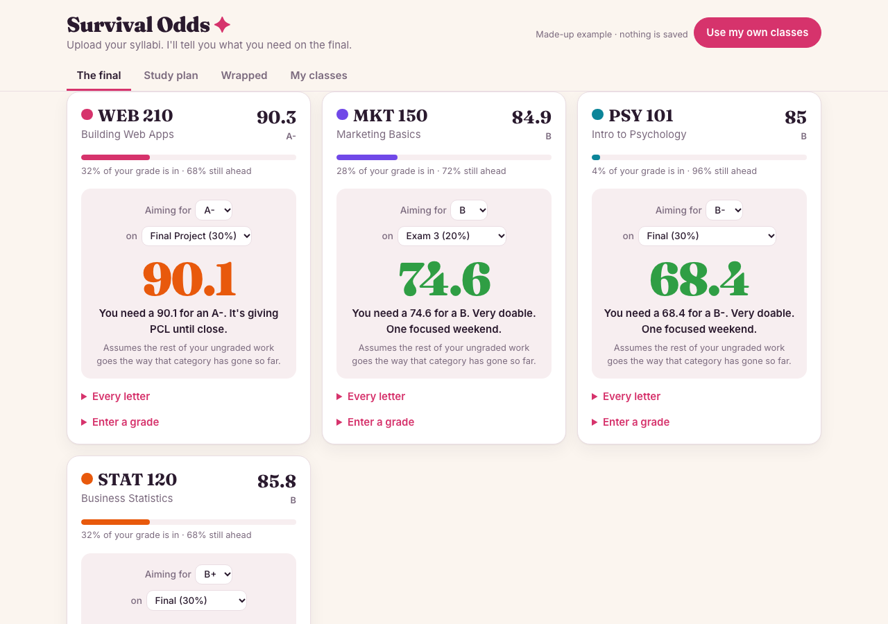
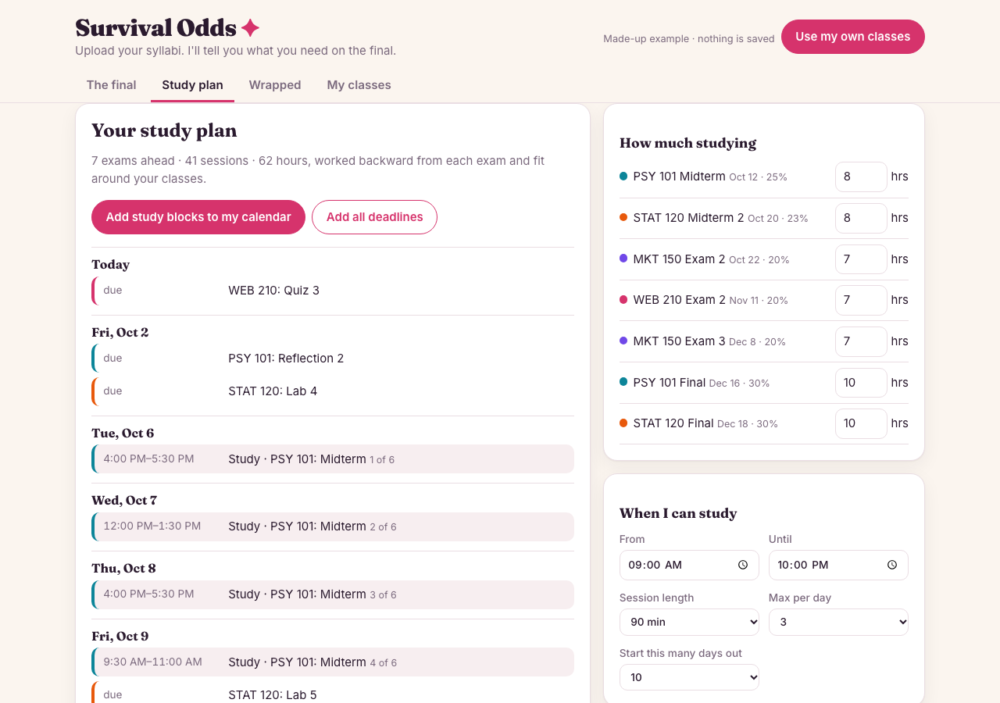
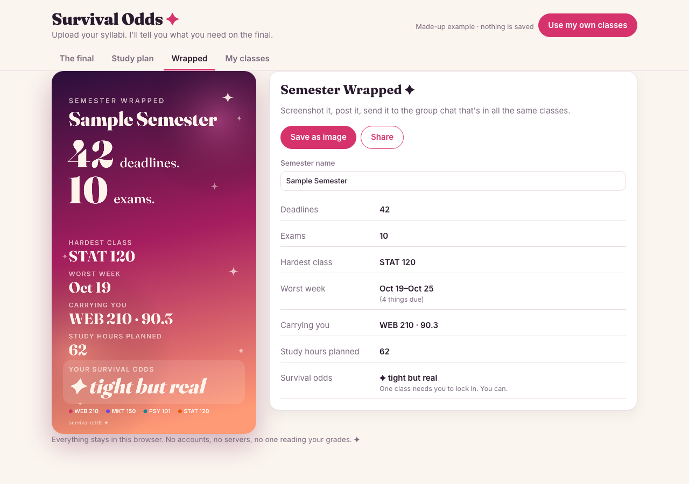

# Survival Odds ✦

*Upload your syllabi. I'll tell you what you need on the final.*

[](https://github.com/suhxnitiwari/survival-odds/actions/workflows/ci.yml)

**Live:** https://suhxnitiwari.github.io/survival-odds/ (open [`?example`](https://suhxnitiwari.github.io/survival-odds/?example) for a made-up semester)

## What it is

Survival Odds reads your syllabi, pulls out the grade weights, class times and exam dates, and then does the three things I actually want during a semester:

1. **"What do I need on the final?"** Enter grades as they come back and get the exact score you need for the grade you want. *"You need a 71 for an A. You're fine. Go to Cosmic."*
2. **Study blocks that plan themselves.** It works backward from every exam and fits study sessions around your classes, your work shifts, and Saturday brunch.
3. **Semester Wrapped.** A story-sized card of your semester (deadlines, exams, hardest class, worst week, survival odds) to post or send to the group chat.

It runs entirely in your browser. No accounts, no server, and nobody else sees your grades.



| Study plan | Semester Wrapped |
| --- | --- |
|  |  |

## How it's built

The interesting parts are a rule-based syllabus parser, weighted grade math that stays honest about what it doesn't know yet, a cost-based study scheduler, and standards-correct calendar export. All of it is plain JavaScript modules with 40 `node:test` tests, and CI runs them before every GitHub Pages deploy, so a failing test blocks the release.

### Reading a syllabus

Drop in one or more PDFs, or paste the text. Pick who reads it:

- **Built-in reader** (default): free and private. The PDF is opened in your browser with pdf.js and nothing is uploaded.
- **Gemini** (optional): better with messy syllabi. It's called with a strict JSON response schema at temperature 0. It's free with your own [Google AI Studio](https://aistudio.google.com/apikey) key, but the syllabus text is sent to Google. The key stays in your browser.

Either way, you see a review card before anything is saved: the weights and their total, class times, dated exams, and a warning for anything that looks off. Gemini's answer goes through the same checks as the built-in reader, so a model mistake shows up as a warning instead of quietly ending up in your grades.

#### How the built-in reader works

Syllabi don't share a format, so [`js/parser.js`](js/parser.js) looks for the *shape* each piece of information usually takes:

| Looking for | Rule |
| --- | --- |
| **Grade weights** | The first run of `Label … 20%` lines (or `20% Label`) that adds up to exactly 100. Grade-scale ranges (`93–100%`), late penalties and curve lines are skipped. |
| **Nested weights** | `40% Participation` followed by its 10% + 15% + 15% sub-parts: the sub-parts win, because starting the run at the first child is what adds to 100. |
| **Wrapped table rows** | When a `%` line has no label (`90 (10 pts each) 22.5%`), the label is the first line after the previous row. `90 (10 pts each)` also means 9 items. |
| **Split columns** | When a PDF stores the percentages and the labels as separate columns, they're matched back up in order. |
| **Class times** | `MW 11:00am-12:15pm`, `Tue/Thu 11:00 AM - 12:30 PM`, `Mondays & Wednesdays`, `TTh`, `T/Th`, `TR`… Office hours and review sessions are skipped. |
| **Exam dates** | Lines naming an exam and a date (`Exam 1 - Oct. 12`, `W 3/4 Exam 1`). Review days don't count. Dates with no year go to the closest semester. |
| **Drop the lowest** | "We'll drop your lowest quiz" sets the Quizzes category to drop one. |

While building it I tested it against real syllabi from 7 different courses, with very different layouts. It found weights adding to exactly 100% in all 7. The tests use made-up syllabi written in those same layouts.

### The grade math

Each category's weight is split across its items by points, so a 100-point exam counts twice as much as a 50-point one in the same category ([`js/grades.js`](js/grades.js)).

- **Current grade** counts only what's been graded.
- **What you need on the final** assumes the rest of your ungraded work goes the way that category has gone so far. If homework is at 95%, the homework left is projected at 95%.
- **Drop the lowest** only kicks in once a category is fully graded. Until then it doesn't guess which one you'll drop, so the numbers stay honest.
- **Weights that don't add to 100** are scaled so they do, and the review screen warns you.

### The study planner

Every open half-hour in the days before an exam gets a cost, and the cheapest slot wins, the same approach as [Saturday in Austin](https://github.com/suhxnitiwari/saturday-in-austin). The rules live as data in [`js/planner.js`](js/planner.js):

- **Spacing beats cramming:** a second session for the same exam on the same day costs a lot, and a third isn't allowed.
- **Most sessions land in the last four days,** plus a small bonus for a review the day before.
- **Busy days cost more** with each block already on them.
- **After 9 PM** costs a little, and so does before 9:30.
- **It's Saturday. We're getting brunch.** Saturday 9:30–1:30 is avoided when possible.
- **Never** during class, a busy block, or 15 minutes on either side of them. On exam day, only a warm-up that ends an hour before.

Exams are planned soonest first, since they have the fewest days to work with. If there isn't enough time, it tells you how many hours short you are. Default hours scale with how much the exam is worth (about 2 hours plus 1 for every 4% of your grade), and you can change any of them.

Study blocks and deadlines export as `.ics` files (RFC 5545: escaped text, CRLF line endings, lines folded at 75 bytes without splitting a character).

## Design choices

- **Private by default.** No accounts and no server. Everything is saved in localStorage, wrapped so a browser that blocks storage never breaks the app, and your syllabi and grades only leave your device if you choose the optional Gemini reader.
- **Review before save.** Nothing a reader extracts goes into your grades until you've seen it, with warnings on anything suspicious.
- **A voice that sounds like a friend in your class,** not a learning-management system: "You need a 71 for an A. You're fine."
- **Semester Wrapped** borrows the year-in-review format and draws a 1080×1920 story card on a canvas, ready to post.
- Fraunces and Inter type, with light and dark mode.

## Tech stack

HTML, CSS, vanilla JavaScript (ES modules), pdf.js, Canvas API, optional Gemini API, node:test, GitHub Actions + GitHub Pages.

## Run it locally

It's plain HTML, CSS and JavaScript modules. There's no build step.

```bash
python3 -m http.server 8000     # then open http://localhost:8000
npm test                        # 40 tests, Node 22+
```

Open `?example` to see a made-up semester without touching your saved data.

## Project layout

```
index.html
css/style.css
js/
  app.js        UI: tabs, forms, review cards, downloads
  grades.js     weights, current grade, what you need on the final
  planner.js    study blocks, the rules as data
  parser.js     the built-in syllabus reader
  importer.js   turns a reader's result into a class, with checks and warnings
  ai.js         optional Gemini reader (structured JSON output)
  pdf.js        PDF text in the browser with pdf.js
  stats.js      the numbers behind Semester Wrapped
  card.js       draws the Wrapped card on a 1080×1920 canvas
  ics.js        calendar export
  store.js      localStorage, wrapped so blocked storage never breaks the app
  sample.js     the made-up example semester
test/           node:test suites and a made-up syllabus fixture
```

Built by [Suhani Tiwari](https://suhanitiwari.com).
